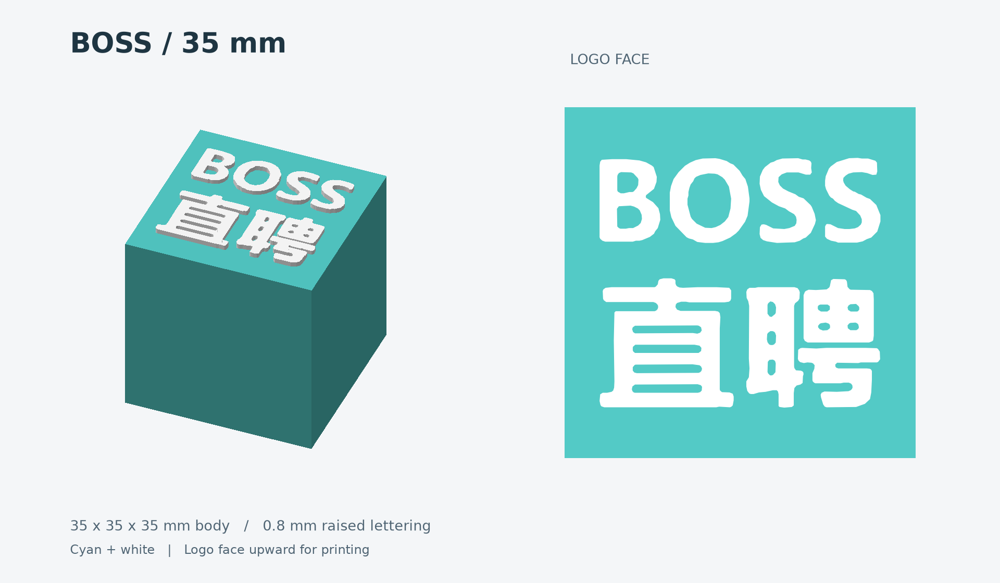
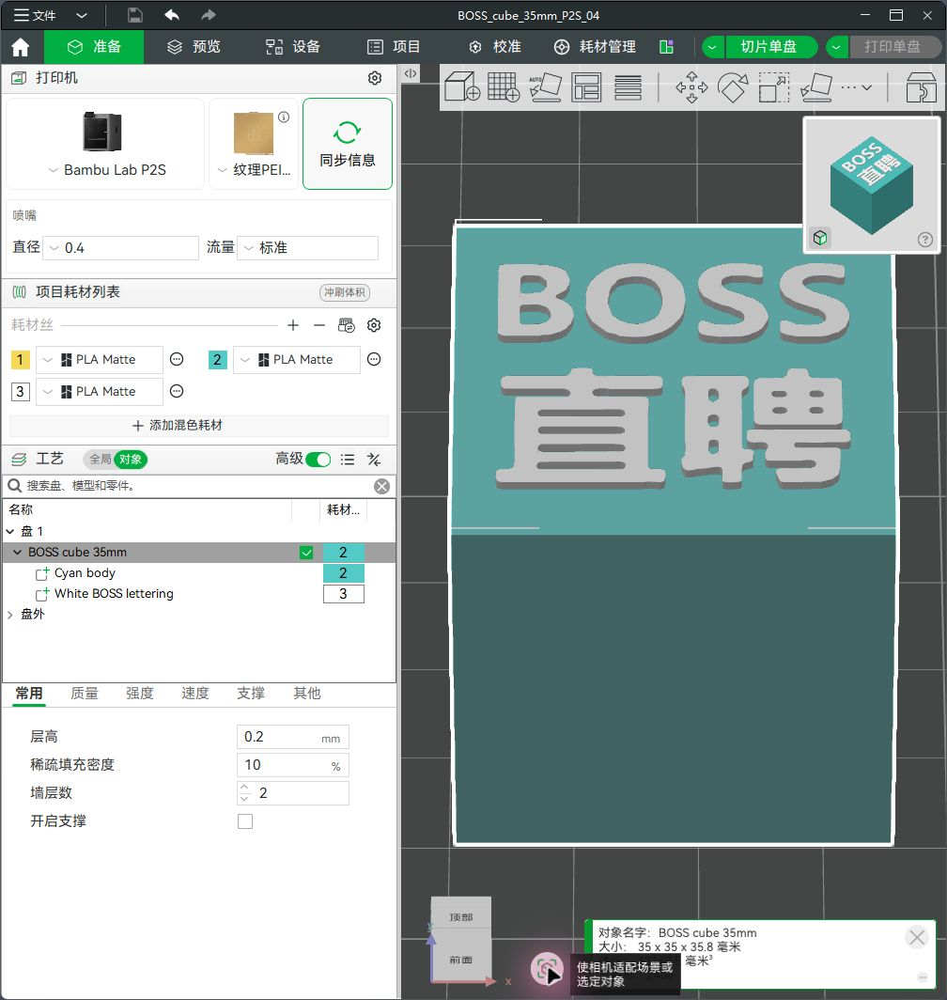
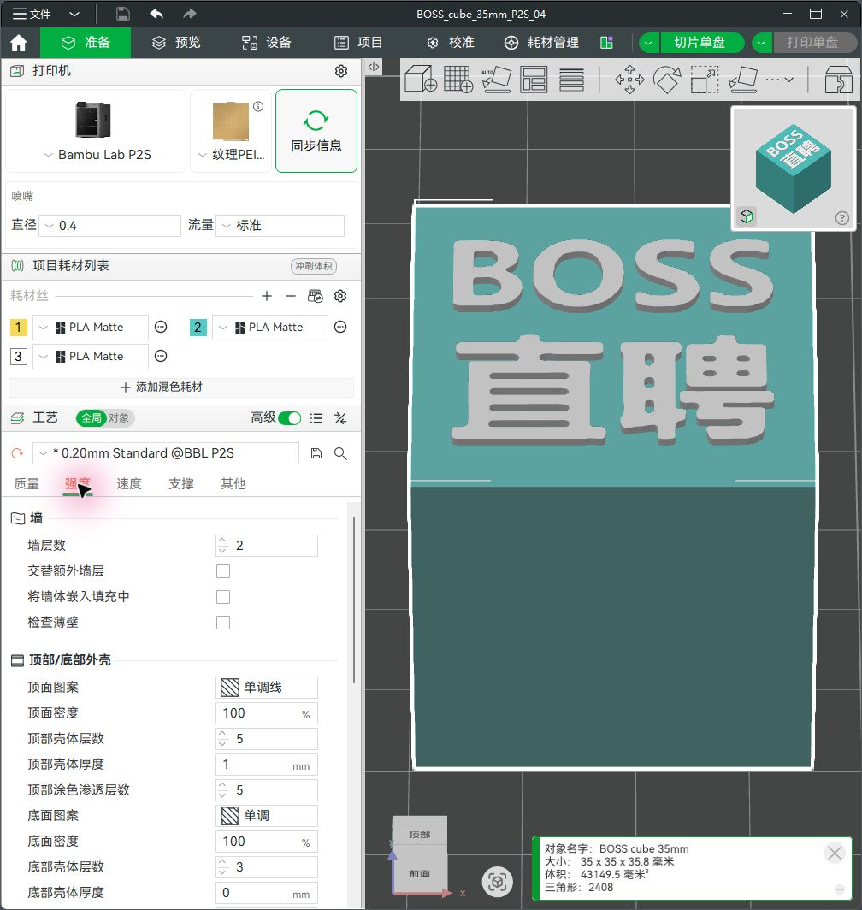
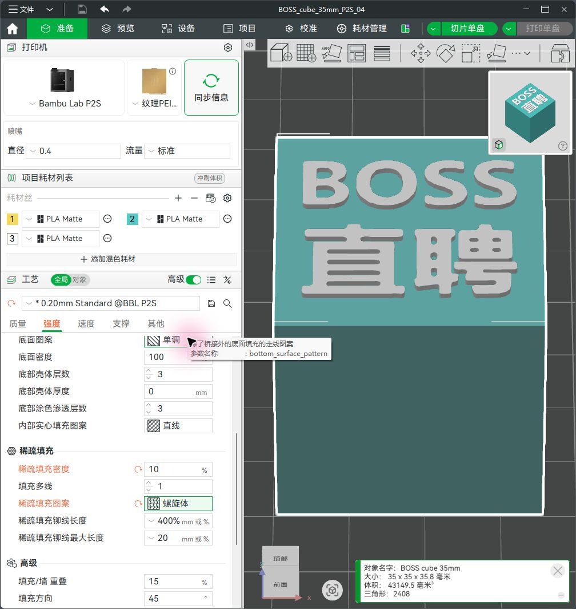
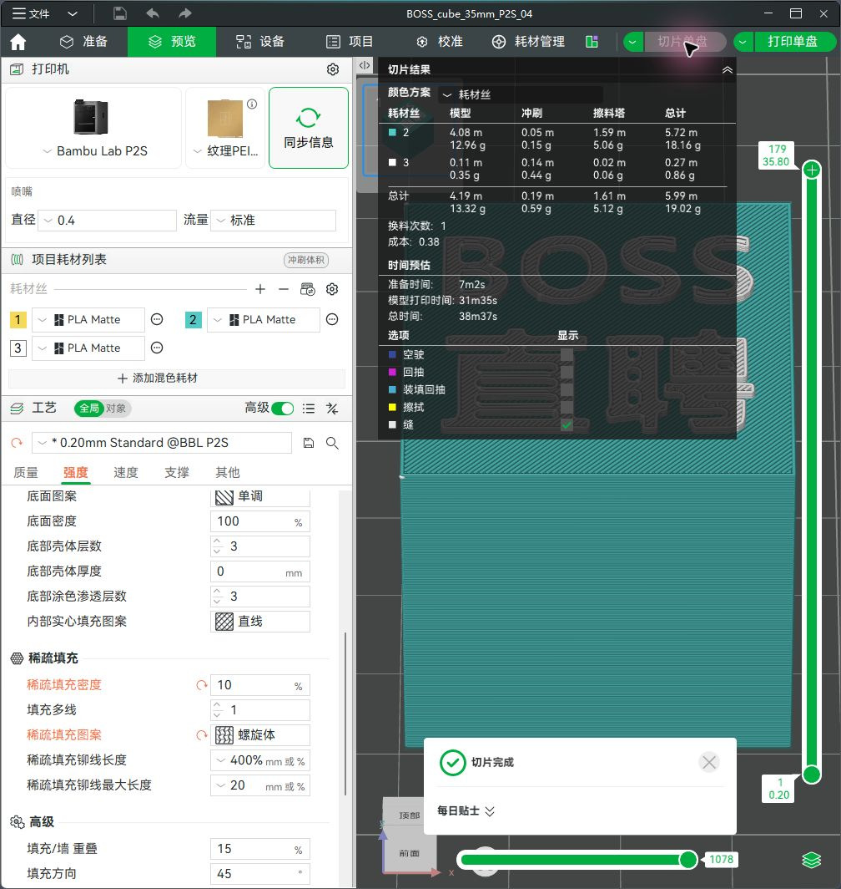
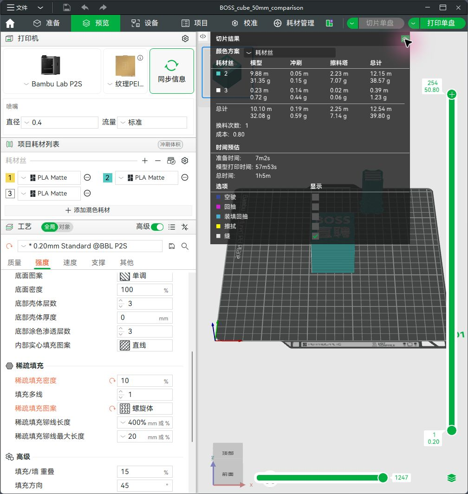
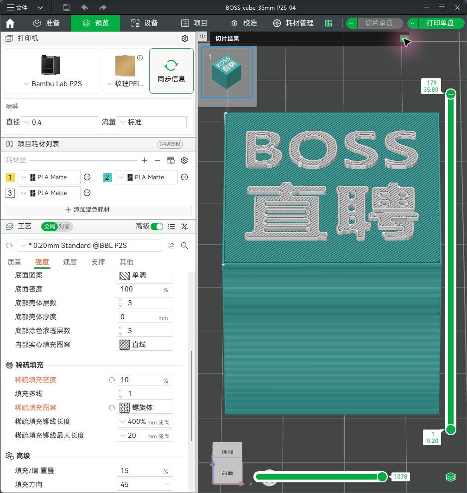
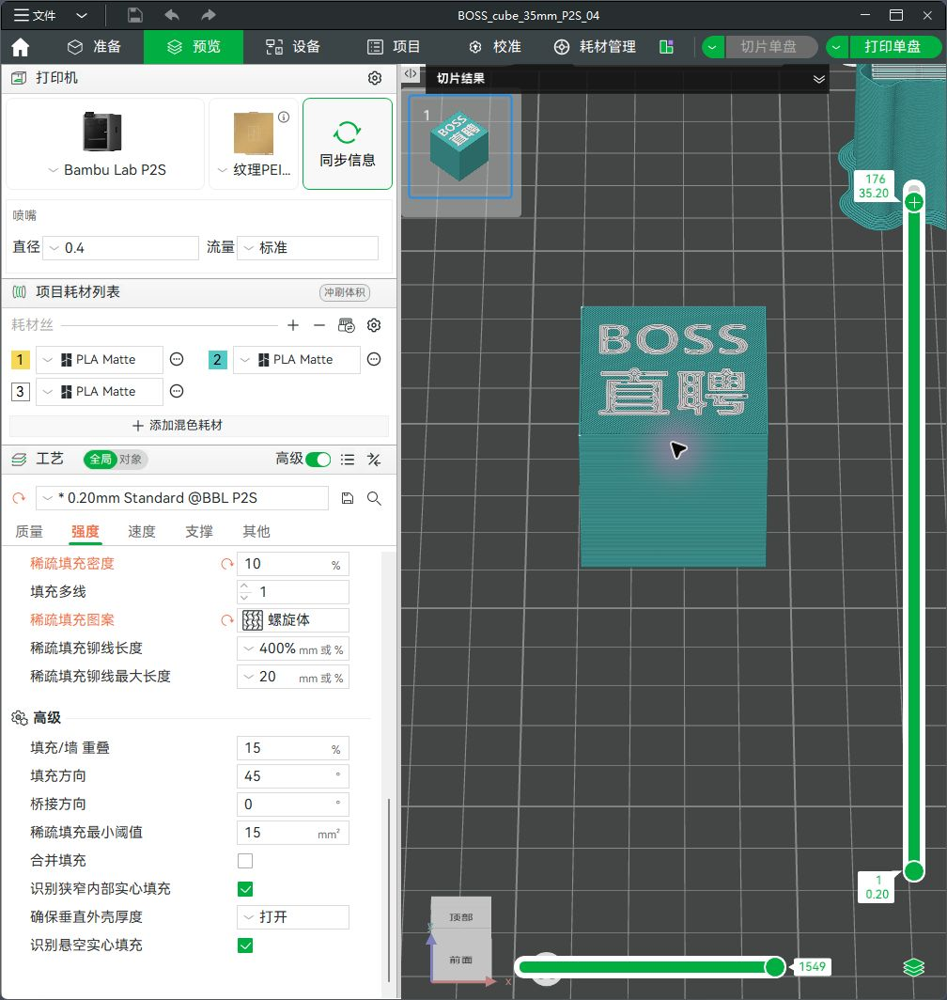
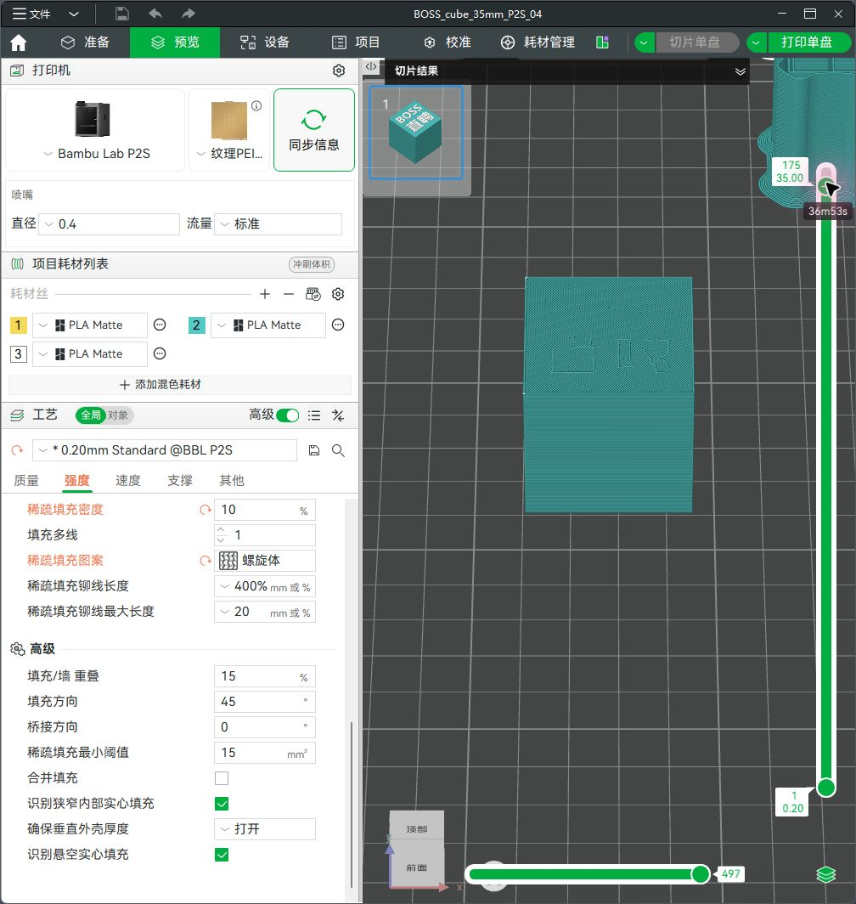

# BOSS 直聘 35 毫米双色正方体使用说明

更新日期：2026-11-01。验证软件：本机 Bambu Studio 2.8.2.61 中文界面。

新版已经完成建模、导入、工艺设置和切片检查，没有发送打印任务。原来的 50 毫米文件保留。

**当前打印机未连接。** 工程内的青白颜色和 PLA Matte 耗材配置已经设置，但两卷实物耗材的材质、型号和 AMS 槽位尚未读取。请在重新连接后完成第 3、4、6 步；本文件不把项目编号当作实际槽位。

## 交付文件与模型规格

优先打开 **`BOSS_cube_35mm_P2S_04.3mf`**：这是含 P2S 0.4 毫米喷嘴、工艺和部件分色的 Bambu Studio 工程。

| 文件 | 用途 |
|---|---|
| `BOSS_cube_35mm_P2S_04.3mf` | 本次设置完成的 Bambu 工程，重新切片即可检查 |
| `BOSS_cube_35mm.3mf` | 不绑定打印机的通用彩色模型，两部件属于同一对象 |
| `body_cyan.stl`、`lettering_white.stl` | 主体、文字独立网格；保留装配坐标，STL 本身不保存颜色 |
| `preview.png` | 外观示意图，实际颜色取决于耗材 |
| `source/` | 可重复生成模型的 Python 源码、参考图和参数清单 |
| `comparison/BOSS_cube_50mm_P2S_04_comparison.3mf` | 同一工艺下的 50 毫米对比工程 |
| `geometry_validation.json`、`project_validation.json` | 几何与最终工程检查记录 |
| `slice_comparison.json` | 两尺寸的切片估算与验证条件 |
| `screenshots/` | 本次实际界面截图，与说明书一起保留 |

主体为 **35 × 35 × 35 毫米**直角正方体；白色文字宽 **28 毫米**，凸起 **0.8 毫米**；含文字总尺寸为 **35 × 35 × 35.8 毫米**。文字从参考图提取，保留大写「BOSS」和第二行「直聘」、字内孔洞与排版。文字面朝上，背面在打印板上，其余五面没有图案。

## 1. 打开新版，识别两个部件

1. 在 Bambu Studio 中选择“文件 → 打开项目”（或 `Ctrl+O`），打开 `BOSS_cube_35mm_P2S_04.3mf`。若询问打开方式，选择加载完整项目，以保留工艺。
2. 在左侧“工艺”区域切换到“对象”，展开 **BOSS cube 35mm**。
3. 应看到 **Cyan body**（青色主体）与 **White BOSS lettering**（白色文字）两个部件。它们必须处于同一对象下。
4. 查看顶面，BOSS 在上、直聘在下，文字没有镜像。模型总高度应为 35.8 毫米。

请直接使用新版文件。把原版整个对象统一缩至 70% 会把文字凸起也缩为 0.56 毫米，与本版保持 0.8 毫米的设计不同。

## 2. 核对打印机、喷嘴、打印板与工艺

“准备”页左上角应显示 **Bambu Lab P2S**，喷嘴直径 **0.4**，流量“标准”。本次依据你确认的实际安装喷嘴设置为 0.4 毫米。打印板配置为**纹理 PEI 打印板**，使用前核对实物；若换了其他板材，请同步修改配置。

工艺采用本机已有的 **0.20mm Standard @BBL P2S**，做以下项目内调整。名称前的星号表示与系统预设存在修改，这些修改已保存在工程中。

| 页面 / 参数 | 本次值 |
|---|---|
| 质量：层高 | 0.20 毫米 |
| 质量：首层高度 | 0.20 毫米 |
| 强度：墙层数 | 2 |
| 强度：稀疏填充密度 | 10% |
| 强度：稀疏填充图案 | **螺旋体（Gyroid）** |
| 强度：顶部壳体层数 | 5 |
| 强度：底部壳体层数 | 3 |
| 支撑：启用支撑 | 关闭 |
| 质量：模型熨烫 | 关闭 / 不熨烫 |
| 其他：擦拭塔 | 保留启用和默认设置 |
| 项目耗材：冲刷体积 | 保留原有默认配置 |

本机 Gyroid 的中文名称是“螺旋体”，与“网格”不是同一个选项。修改参数时选“全局”，避免只改一个部件而遗漏另一个。

## 3. 重新连接后同步 AMS 耗材

1. 在顶部“设备”页选中你的 P2S，确认设备在线、AMS 信息可以显示。若仍显示“无打印机”，先完成连接；当前可继续离线查看模型。
2. 核对 AMS 中两卷实物耗材的颜色、材质、品牌/型号和槽位，并记录下来。槽位以设备实际显示为准，可能带 AMS 单元编号。
3. 返回“准备”页，点击打印机旁的**同步信息**核对硬件配置；再点击“项目耗材列表”旁的**耗材同步图标**，同步 AMS 耗材信息。不要把打印机信息同步当成耗材同步已经完成。
4. 同步后检查项目耗材列表。若出现映射或覆盖选择，完成后都要重新核对部件颜色与耗材设置。第三方或手动登记的耗材应与卷盘标签一致。

拓竹官方 P2S 手册说明了从项目耗材列表同步 AMS 信息的流程；不同 Studio 版本的按钮文字可能变化。[官方 P2S 用户手册](https://csm.bblcdn.com/hub/9425242c00344b0e801b6179f9a243aa.pdf)

**本工程目前沿用 `Bambu PLA Matte @BBL P2S`。这不是实物已验证的结论。** 如果实际是 PLA Basic、其他品牌 PLA 或其他材质，请选择对应耗材预设，再重新切片。青白两卷应适合共同打印这个固定连接模型；不要仅凭颜色把不同材质当作相同耗材。

## 4. 分配主体与文字，理解项目编号和槽位

当前保存的 Bambu 工程使用如下分配：

| 部件 / 用途 | 当前项目耗材编号 | 显示颜色 | 当前耗材预设 | 实际 AMS 槽位 |
|---|---|---|---|---|
| Cyan body | **2** | 青色 `#53CAC6` | Bambu PLA Matte，待实物核对 | 待连接确认 |
| White BOSS lettering | **3** | 白色 `#FFFFFF` | Bambu PLA Matte，待实物核对 | 待连接确认 |
| 未使用的原项目耗材 | 1 | 黄色 | 不参与本模型切片 | 无需映射给模型 |

项目编号是当前工程的材料列表序号；AMS 槽位是机器上的实际供料位置。**项目 2 不等于 AMS 第 2 槽，项目 3 也不等于第 3 槽。** 通用彩色 3MF 的内部颜色顺序还可能不同，所以始终根据部件、材质和颜色核对。

在“对象”列表中，点击 **Cyan body** 行右侧的耗材色块，选择当前列表中的青色耗材；点击 **White BOSS lettering** 行右侧色块，选择白色耗材。展开对象后逐个部件设置，不要只修改父对象。当前父对象也已设为青色。

同步可能改变列表顺序，因此同步后再检查这两个部件。黄色条目留在列表中不代表会打印黄色；切片统计里的实际使用材料才是判断依据。

这里的“换料”是 **AMS 自动从青色切换到白色**。在两卷已装好且映射正确的前提下，不需要你中途暂停或人工换卷，也不需要另外添加暂停换料命令。

## 5. 切片、检查文字与耗材量

点击右上角**切片单盘**。完成后进入“预览”，展开“切片结果”，将“颜色方案”设为“耗材丝”。

本次同一工艺下得到以下估算。50 毫米版本的界面把时间取整显示为“1h5m”，切片数据中的时间为 1 小时 4 分 55 秒。

| 项目 | 35 毫米新版 | 50 毫米对比版 |
|---|---:|---:|
| 准备时间 | 7 分 2 秒 | 7 分 2 秒 |
| 模型打印阶段 | 31 分 35 秒 | 57 分 53 秒 |
| **总预计时间** | **38 分 37 秒** | **约 1 小时 5 分** |
| **总耗材，含冲刷和擦拭塔** | **19.02 克** | **39.80 克** |
| 模型本体耗材 | 13.32 克 | 32.08 克 |
| 冲刷耗材 | 0.59 克 | 0.59 克 |
| 擦拭塔耗材 | 5.12 克 | 7.14 克 |
| 青色总量 | 18.16 克 | 38.57 克 |
| 白色总量 | 0.86 克 | 1.23 克 |
| 换料次数 | 1 | 1 |
| 总层数 | 179 | 254 |

界面各项分别四舍五入，相加可能相差 0.01 克。35 毫米版预计减少约 **40.5% 时间、52.2% 总耗材**；这些是现有 PLA Matte 配置下的软件估算，不是按体积比例承诺，也不是实物计时。

检查时按以下顺序操作：

1. 统计中只应出现青色、白色两种实际耗材。目前是项目 **2、3**，换料次数 **1**。如果出现黄色耗材用量，回到第 4 步检查所有部件分配。
2. 用右侧层滑块检查顶面。主体到第 **175 层 / Z=35.0 毫米**结束；首层白字为第 **176 层 / Z=35.2 毫米**；白字连续打印到第 **179 层 / Z=35.8 毫米**，共四层。
3. 放大 BOSS 和直聘，检查每个笔画有路径，B、O 和汉字内孔没有意外填死。首层白字应位于青色顶面之上；不能落到板上或悬在主体之外。
4. 检查文字下方青色顶面连续。保留默认擦拭塔，它是模型旁的独立辅助结构，帮助换色后稳定挤出，不是第二个要交付的正方体。
5. 冲刷颜色图例中的黄色“擦拭”标记是动作标记，不一定代表黄色耗材；判断意外用色应看“耗材丝”配色和材料统计。

下图分别为第 176 层首层白字和第 175 层青色接触顶面，已经逐层查看：白字笔画都有路径，下方青色表面连续。

## 6. 由你在发送窗口确认映射并开始打印

这一步留给你重新连接并准备实际打印时完成。本次没有执行发送、上传或启动打印。

1. 同步、重新分配和切片检查完成后，点击**打印单盘**打开发送窗口。
2. 选择你的在线 P2S，核对喷嘴和打印板信息，并确认使用 AMS。
3. 在耗材映射区域，逐项核对：**主体青色 → 实际青色卷槽位；文字白色 → 实际白色卷槽位**。颜色相近时也要核对材质，不能只相信自动匹配。
4. 如果槽位显示空、材质不符、两种颜色映射到同一卷，或实际喷嘴不符，取消发送并先修正。改变耗材预设后重新切片。
5. 两项映射正确、打印板准备好后，由你点击窗口内最终的**发送 / 开始打印**按钮。

自动映射与同步的原则可参照拓竹官方手册中的 Bambu Studio 耗材映射说明；最终映射必须对应当时机器上的实际耗材。[拓竹官方耗材映射说明（H2C 手册，共通软件流程）](https://csm.bblcdn.com/hub/eff78da43720461787dc8bbe5fa0372d.pdf)

## 7. 常见问题

| 现象 | 处理方法 |
|---|---|
| 主体变白、文字变青 | 展开对象，分别修正两个部件的耗材。重新切片，再检查发送窗口的槽位映射。 |
| 同步后颜色或编号变了 | 重新按颜色和材质指定部件。旧的项目编号不能作为新列表或 AMS 槽位的依据。 |
| 仍显示 0.2 喷嘴或提示喷嘴不匹配 | 核对实际硬件与 P2S 0.4 配置；连接后同步信息。软件改成 0.4 不会改变实体喷嘴。 |
| 文字缺笔或孔洞消失 | 确认打开的是本版 35.8 毫米总高模型、0.4 喷嘴、0.2 层高；放大检查第 176–179 层。不要继续缩小字宽或把字高也等比缩小。若修改过线宽/墙生成器，先回到交付工程。 |
| 白字掉到打印板 | 通常是把文字作为独立对象导入后自动落板。撤销，改用完整 3MF；或同时导入两个 STL，选择作为一个对象的多个部件，保留相对坐标。 |
| 打印时间仍较长 | 先核对 35 毫米、0.4 喷嘴、0.2 层高、10% 螺旋体、没有额外副本或支撑。准备时间、冲刷与擦拭塔不会随体积同比减少。保留当前默认擦拭塔和冲刷；后续更改须重新检查切片。 |
| 导入提示“3MF 配置无效，仅加载几何数据” | 这是打开不含完整 Studio 工艺的通用 `BOSS_cube_35mm.3mf` 时可能出现的提示。它仍可作为几何模型导入，但需要自行选择机器、工艺及颜色。想直接使用本次工艺，请打开带 `_P2S_04` 的工程文件。 |
| 项目里有黄色编号 1 | 本次保留了原项目未使用的黄色条目；最终切片只有青、白。不要把“存在于列表”误认为“会被使用”。 |
| 没有连接打印机 | 可以离线查看和切片。AMS 实际槽位及实物材质等连接后核对，不能把本次离线配置视为已经完成设备映射。 |

## 验证范围

已完成：两部件网格封闭、法线方向一致、正体积；主体 35 毫米、文字宽 28 毫米且厚 0.8 毫米；文字底面与主体顶面在 Z=35 毫米接触，所有笔画都落在主体范围内；保留 8 个文字连通部分、14 个轮廓孔洞。最终 Bambu 工程的网格与参数也单独核对。

已在 Bambu Studio 导入并切片，核对部件、青白分配、文字顶层路径、第 175 层青色接触顶面、第 176 层首层白字、换料次数和统计；切片记录中只有项目耗材 2、3，没有黄色耗材路径。软件验证不能替代试打对实际粘合、颜色遮盖和尺寸误差的确认。

尚未完成且不冒充已完成：读取离线设备的真实 AMS 槽位和耗材型号、发送窗口的实际槽位映射、实物打印测试。这些在你重新连接并决定打印后执行。

本说明的操作位置以附图中的实际界面为准，工艺值来自本次工程检查；官方资料用于同步与映射流程参考。原始 50 毫米交付文件没有被覆盖。
