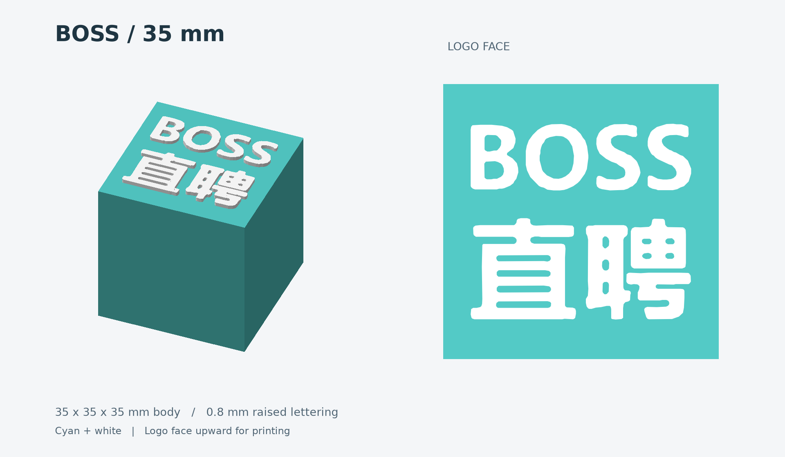
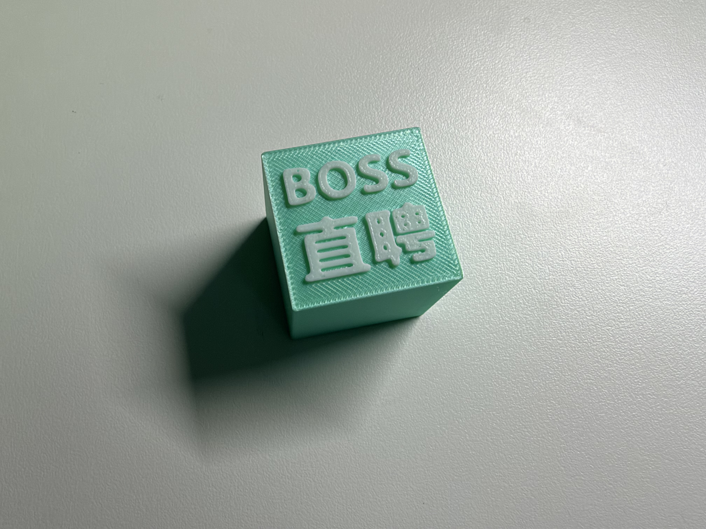
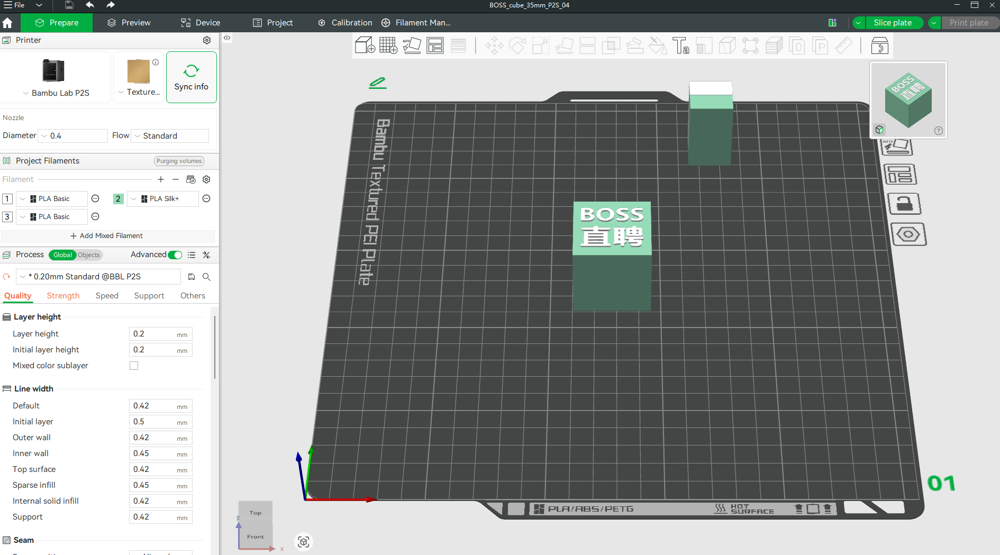

# BOSS Cube

English | [简体中文](README.zh-CN.md)

Generate a two-color BOSS Zhipin cube with raised lettering from a reference image, available in **35 mm** and **50 mm** sizes. Each model consists of a cyan body and white raised lettering. The outlines are extracted directly from the image, preserving its layout and the holes inside the characters.

This repository includes Python generators, generic 3MF / STL models, a 35 mm Bambu Studio project, previews, usage guides, and validation records.



## Model specifications

| Property | 35 mm | 50 mm |
| --- | --- | --- |
| Body dimensions | 35 × 35 × 35 mm | 50 × 50 × 50 mm |
| Overall dimensions, including lettering | 35 × 35 × 35.8 mm | 50 × 50 × 50.8 mm |
| Lettering width | 28 mm | 40 mm |
| Lettering relief height | 0.8 mm | 0.8 mm |
| Body / lettering colors | Cyan `#53CAC6` / white | Cyan `#53CAC6` / white |

Print with the lettering facing upward and the back of the cube on the build plate. Both sizes contain two parts: the body and the lettering. The lettering retains 8 connected components and 14 outline holes.

## 3D-Printed Result

A cyan body and raised white lettering bring the BOSS Zhipin artwork into a two-color physical print.

### Printed Cube



The finished cube shows the raised lettering and printed surface texture.

### Bambu Studio Preview



The 35 mm project in Bambu Studio, with the lettering facing upward.

## Use the existing models

Python is not required to use the existing models.

| File | Purpose |
| --- | --- |
| [35 mm P2S project](models/BOSS_cube_35mm/BOSS_cube_35mm_P2S_04.3mf) | Bambu Studio project with printer, process, and part filament assignments |
| [35 mm generic model](models/BOSS_cube_35mm/BOSS_cube_35mm.3mf) | Generic 3MF with part colors, without a printer process profile |
| [50 mm generic model](models/BOSS_cube_50mm/BOSS_cube_50mm.3mf) | Generic 3MF with part colors, without a printer process profile |
| [50 mm comparison project](models/BOSS_cube_35mm/comparison/BOSS_cube_50mm_P2S_04_comparison.3mf) | Project configured for slicing comparisons with the 35 mm version |

Each size directory also contains `body_cyan.stl` and `lettering_white.stl`. STL files do not store colors. Import both files as multiple parts of a single object and preserve their assembly coordinates.

The 35 mm project stores a Bambu Lab P2S configuration with a 0.4 mm nozzle, 0.20 mm layer height, 2 wall loops, 10% Gyroid infill, 5 top shell layers, and 3 bottom shell layers. Supports and ironing are disabled, the prime tower is enabled, and the bed type is Textured PEI Plate.

The project uses Bambu PLA Matte presets, with project filament 2 assigned to the body and filament 3 assigned to the lettering. **Project filament numbers are not physical AMS slot numbers.** Before printing, check the actual filament, nozzle, build plate, and AMS mapping, then slice again and inspect the lettering toolpaths.

For detailed steps, see the [35 mm usage guide](models/BOSS_cube_35mm/USAGE.en.md) and [50 mm usage guide](models/BOSS_cube_50mm/USAGE.en.md).

## Repository structure

```text
.
├── README.md                     # English project guide
├── README.zh-CN.md               # Simplified Chinese project guide
├── scripts/                      # Modeling, project preparation, and delivery scripts
├── assets/
│   └── reference/images.jpg      # Modeling reference image
├── models/
│   ├── BOSS_cube_35mm/            # 35 mm models, project, guides, and validation records
│   │   ├── comparison/           # 50 mm comparison project with matching process settings
│   │   ├── screenshots/          # Bambu Studio inspection screenshots
│   │   └── source/               # Standalone delivery source, image, and process settings
│   └── BOSS_cube_50mm/            # 50 mm models, guide, and validation records
│       └── source/               # Standalone delivery source and image
├── docs/
│   ├── commit-conventions.md     # Chinese commit message conventions
│   └── commit-conventions.en.md  # English commit message conventions
└── archive/
    ├── packages/                 # Historical ZIP delivery packages
    ├── qa/                       # Seed project, slicing results, and investigation files
    ├── cache/                    # Historical caches
    └── results/                  # Historical run results
```

ZIP files in `archive/packages/` are historical snapshots and are not automatically updated when the source changes.

## Generate models from source

Install Python 3.11 or later and uv, then run these commands from the repository root:

```sh
# Generate the 35 mm model
uv run scripts/build_model_35mm.py

# Generate the 50 mm model
uv run scripts/build_model.py
```

Both scripts declare their dependencies in their headers. uv creates a runtime environment and installs NumPy, Pillow, OpenCV, Shapely, trimesh, mapbox-earcut, and Matplotlib.

The generators read `assets/reference/images.jpg` and write to `models/BOSS_cube_35mm/` and `models/BOSS_cube_50mm/`, respectively:

| Output | Content |
| --- | --- |
| `BOSS_cube_35mm.3mf` or `BOSS_cube_50mm.3mf` | Generic color model |
| `body_cyan.stl` | Cyan body mesh |
| `lettering_white.stl` | White lettering mesh |
| `preview.png` | Model preview |
| `lettering_outline.json` | Extracted lettering outlines |
| `geometry_validation.json` | Geometry validation results |

Running a generator again overwrites these files. It does not update the `_P2S_04` process projects, slicing statistics, or historical ZIP packages. Existing records do not automatically reflect geometry changes.

Dimensions are defined by `SIDE`, `LOGO_WIDTH`, and `RELIEF` in each generator, in millimeters. When changing dimensions, review the corresponding assertions. The 50 mm script also contains fixed dimensions in export metadata, previews, and validation values.

The delivery copy of `source/build_model.py` can run independently. For example:

```sh
cd models/BOSS_cube_35mm/source
uv run build_model.py
```

This reads `images.jpg` beside the script and creates a `BOSS_cube_35mm/` subdirectory inside the current `source/` directory. Delivery source copies are stored separately from the main scripts in `scripts/`; editing a main script does not automatically synchronize all copies. See the [standalone source guide](models/BOSS_cube_35mm/source/README.en.md) for details.

## Prepare projects and finalize deliveries

These scripts reproduce the existing delivery workflow. They are not needed to view models or regenerate generic geometry.

| Script | Inputs and behavior |
| --- | --- |
| `scripts/prepare_projects.py` | Reads `archive/qa/original50_session.3mf` and writes the 35 mm P2S project and `archive/qa/BOSS_cube_50mm_comparison.3mf` |
| `scripts/finalize_delivery.py` | Checks the 35 mm project and archived slicing data, then updates delivery validation reports, slicing comparisons, the 35 mm source copy, and the comparison project |

The preparation script uses only the Python standard library. Run it from the repository root:

```sh
uv run scripts/prepare_projects.py
```

It scales the geometry in the archived seed project directly. It does not read new output from the generic generators or invoke a slicer. Running it overwrites the corresponding project files.

The finalization script requires NumPy, trimesh, and a mesh connectivity analysis dependency. You can provide these dependencies for the run through uv:

```sh
uv run --with numpy --with trimesh --with scipy scripts/finalize_delivery.py
```

Before running it, retain `result35.json`, `result50.json`, `comparison35_sliced.3mf`, and `comparison50_sliced.3mf` in `archive/qa/`, along with the existing 35 mm P2S project. The script reads existing slicing results and does not slice again. If geometry or process settings have changed, update the corresponding slicing inputs first. It rewrites some validation reports; manually added GUI inspection fields in those reports are not automatically preserved.

## Validation and slicing records

The existing [35 mm geometry report](models/BOSS_cube_35mm/geometry_validation.json), [50 mm geometry report](models/BOSS_cube_50mm/geometry_validation.json), and [35 mm project validation record](models/BOSS_cube_35mm/project_validation.json) document checks for watertight meshes, consistent winding, positive volume, correct dimensions, and lettering that contacts and is supported by the body.

The saved [slicing comparison](models/BOSS_cube_35mm/slice_comparison.json) uses a P2S with a 0.4 mm nozzle, 0.20 mm Standard process, 10% Gyroid infill, and existing PLA Matte presets:

| Metric | 35 mm | 50 mm comparison project |
| --- | --- | --- |
| Total estimated time | 38 min 37 sec | 1 hr 4 min 55 sec |
| Total filament, including flushing and prime tower | 19.02 g | 39.80 g |
| Layers | 179 | 254 |
| Filament changes | 1 | 1 |

These are software estimates for the saved configuration. The records do not verify physical AMS slots or actual filament rolls, and no physical print test has been performed. Recheck and slice again after changing the printer, filament, or process settings.
