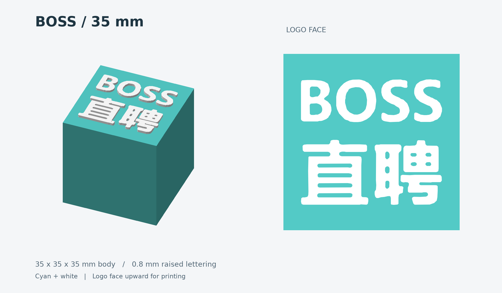
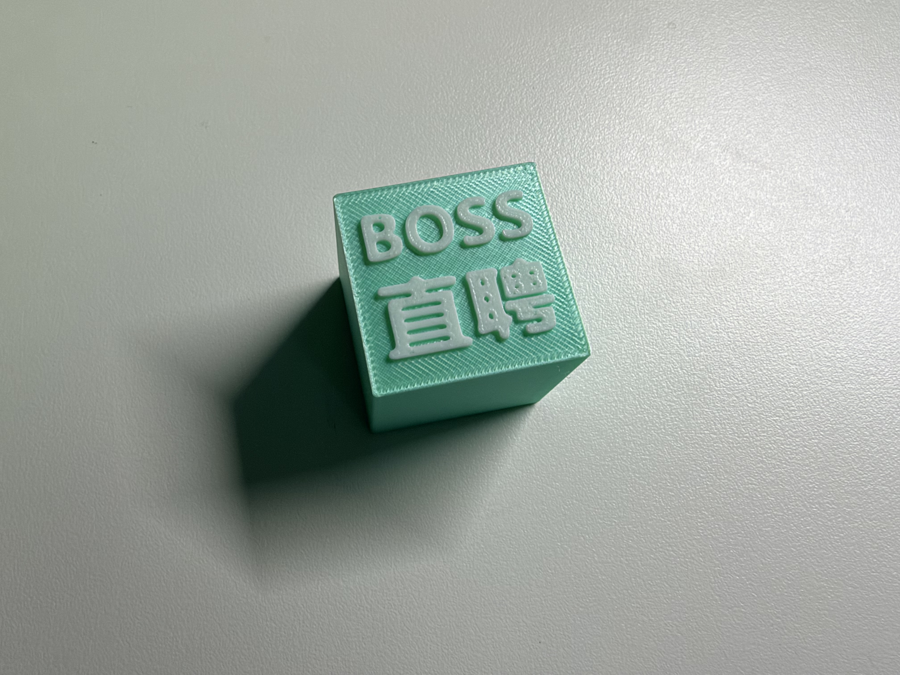
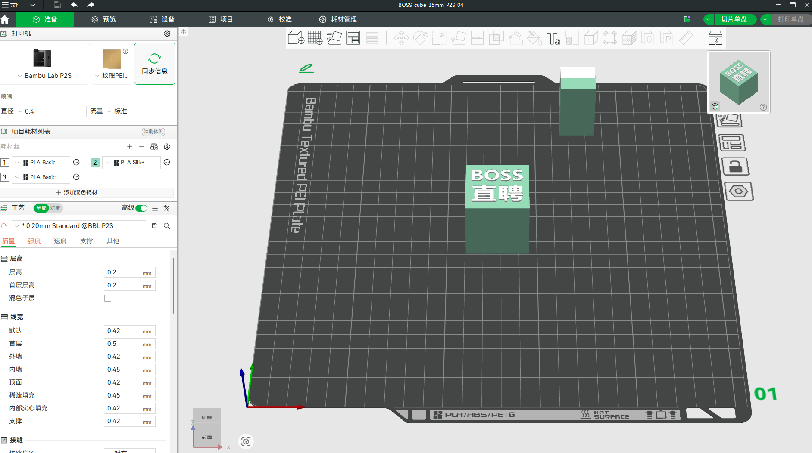

# BOSS Cube

[English](README.md) | 简体中文

基于参考图片生成 BOSS 直聘双色浮雕正方体，提供 **35 mm** 和 **50 mm** 两种尺寸。模型由青色主体与白色凸起文字组成，字形直接从图片提取，保留原图排版和字内孔洞。

仓库包含 Python 生成脚本、通用 3MF / STL 模型、35 mm Bambu Studio 工程，以及预览图、使用说明和验证记录。



## 模型规格

| 项目 | 35 mm | 50 mm |
| --- | --- | --- |
| 主体尺寸 | 35 × 35 × 35 mm | 50 × 50 × 50 mm |
| 含文字总尺寸 | 35 × 35 × 35.8 mm | 50 × 50 × 50.8 mm |
| 文字宽度 | 28 mm | 40 mm |
| 文字凸起高度 | 0.8 mm | 0.8 mm |
| 主体 / 文字颜色 | 青色 `#53CAC6` / 白色 | 青色 `#53CAC6` / 白色 |

打印方向为文字面朝上，背面位于打印板。两个尺寸均包含主体和文字两个部件，文字保留 8 个连通部分、14 个轮廓孔洞。

## 3D 打印成品展示

青色主体搭配白色浮雕文字，呈现 BOSS 直聘标识的双色打印效果。

### 打印成品



成品照片展示了凸起的文字和打印表面纹理。

### Bambu Studio 工程预览



Bambu Studio 中的 35 mm 工程预览，文字面朝上。

## 直接使用模型

使用现有模型无需安装 Python。

| 文件 | 用途 |
| --- | --- |
| [35 mm P2S 工程](models/BOSS_cube_35mm/BOSS_cube_35mm_P2S_04.3mf) | 含打印机、工艺和部件耗材分配的 Bambu Studio 工程 |
| [35 mm 通用模型](models/BOSS_cube_35mm/BOSS_cube_35mm.3mf) | 带部件颜色的通用 3MF，不绑定打印机工艺 |
| [50 mm 通用模型](models/BOSS_cube_50mm/BOSS_cube_50mm.3mf) | 带部件颜色的通用 3MF，不绑定打印机工艺 |
| [50 mm 同工艺对比工程](models/BOSS_cube_35mm/comparison/BOSS_cube_50mm_P2S_04_comparison.3mf) | 用于与 35 mm 工程比较切片结果 |

各尺寸目录内另有 `body_cyan.stl` 与 `lettering_white.stl`。STL 不保存颜色；同时导入两份 STL 时，应作为同一对象的多个部件加载并保留装配坐标。

35 mm 工程保存的配置为 Bambu Lab P2S、0.4 mm 喷嘴、0.20 mm 层高、2 层墙、10% Gyroid 填充、5 层顶壳和 3 层底壳；关闭支撑与熨烫，启用擦拭塔，打印板为纹理 PEI。

工程中的耗材预设为 Bambu PLA Matte，主体使用项目耗材编号 2，文字使用编号 3。**项目编号不代表实际 AMS 槽位。** 打印前需核对实物耗材、喷嘴、打印板与 AMS 映射，重新切片并检查文字路径。

详细步骤见 [35 mm 使用说明](models/BOSS_cube_35mm/使用说明.md) 与 [50 mm 使用说明](models/BOSS_cube_50mm/使用说明.md)。

## 目录结构

```text
.
├── README.md                     # 英文项目说明
├── README.zh-CN.md               # 简体中文项目说明
├── scripts/                      # 建模、工程准备和交付整理脚本
├── assets/
│   └── reference/images.jpg      # 建模参考图
├── models/
│   ├── BOSS_cube_35mm/            # 35 mm 模型、工程、说明和验证记录
│   │   ├── comparison/           # 50 mm 同工艺对比工程
│   │   ├── screenshots/          # Bambu Studio 检查截图
│   │   └── source/               # 交付用独立源码、图片和工艺参数
│   └── BOSS_cube_50mm/            # 50 mm 模型、说明和验证记录
│       └── source/               # 交付用独立源码和图片
├── docs/
│   ├── commit-conventions.md     # 中文提交信息规范
│   └── commit-conventions.en.md  # 英文提交信息规范
└── archive/
    ├── packages/                 # 历史 ZIP 交付包
    ├── qa/                       # 种子工程、切片结果和排查资料
    ├── cache/                    # 历史缓存
    └── results/                  # 历史运行结果
```

`archive/packages/` 中的 ZIP 为历史快照，不会随当前源码修改自动更新。

## 从源码生成模型

准备 Python 3.11 或更新版本及 uv，在仓库根目录执行：

```sh
# 生成 35 mm 模型
uv run scripts/build_model_35mm.py

# 生成 50 mm 模型
uv run scripts/build_model.py
```

两个脚本均在头部声明依赖，uv 会创建运行环境并安装 NumPy、Pillow、OpenCV、Shapely、trimesh、mapbox-earcut 和 Matplotlib。

生成器读取 `assets/reference/images.jpg`，分别写入 `models/BOSS_cube_35mm/` 与 `models/BOSS_cube_50mm/`：

| 输出 | 内容 |
| --- | --- |
| `BOSS_cube_35mm.3mf` 或 `BOSS_cube_50mm.3mf` | 通用彩色模型 |
| `body_cyan.stl` | 青色主体网格 |
| `lettering_white.stl` | 白色文字网格 |
| `preview.png` | 模型预览 |
| `lettering_outline.json` | 提取的文字轮廓 |
| `geometry_validation.json` | 几何检查结果 |

再次运行会覆盖上述同名文件。生成器不会更新带 `_P2S_04` 的工艺工程、切片统计或历史 ZIP；修改模型后，这些已有记录不会自动反映新几何。

尺寸常量位于各生成脚本的 `SIDE`、`LOGO_WIDTH` 和 `RELIEF` 中，单位为毫米。调整尺寸时需同步检查相关断言；50 mm 脚本中还包含固定尺寸的导出元数据、预览和验证值。

交付目录内的 `source/build_model.py` 可独立运行。例如：

```sh
cd models/BOSS_cube_35mm/source
uv run build_model.py
```

该方式读取脚本旁的 `images.jpg`，在当前 `source/` 下生成 `BOSS_cube_35mm/` 子目录。交付源码副本与 `scripts/` 中的主脚本分开保存，修改主脚本不会自动同步所有副本。详见[独立源码说明](models/BOSS_cube_35mm/source/README.md)。

## 工程准备与交付整理

以下脚本用于复现已有交付流程，日常查看或重新生成通用模型无需运行。

| 脚本 | 输入与行为 |
| --- | --- |
| `scripts/prepare_projects.py` | 读取 `archive/qa/original50_session.3mf`，写入 35 mm P2S 工程及 `archive/qa/BOSS_cube_50mm_comparison.3mf` |
| `scripts/finalize_delivery.py` | 核对 35 mm 工程与归档切片数据，更新交付验证报告、切片对比、35 mm 源码副本及对比工程 |

工程准备脚本只依赖 Python 标准库，可在仓库根目录执行：

```sh
uv run scripts/prepare_projects.py
```

它直接缩放归档种子工程的几何，不读取通用生成器的新输出，也不会调用切片器。运行会覆盖对应的同名工程。

交付整理脚本需要 NumPy、trimesh 及网格连通性分析依赖，可通过 uv 临时提供运行依赖：

```sh
uv run --with numpy --with trimesh --with scipy scripts/finalize_delivery.py
```

运行前需保留 `archive/qa/` 中的 `result35.json`、`result50.json`、`comparison35_sliced.3mf` 和 `comparison50_sliced.3mf`，以及已有的 35 mm P2S 工程。脚本读取现有切片结果，不会重新切片；若模型或工艺已更改，应先更新对应的切片输入。该脚本会重写部分验证报告，原报告中手工补充的界面检查字段不会自动保留。

## 验证与切片记录

现有 [35 mm 几何报告](models/BOSS_cube_35mm/geometry_validation.json)、[50 mm 几何报告](models/BOSS_cube_50mm/geometry_validation.json) 和 [35 mm 工程检查记录](models/BOSS_cube_35mm/project_validation.json) 记录了网格封闭、法线一致、体积为正、尺寸正确，以及文字与主体接触并获得支撑等检查结果。

现有 [切片对比记录](models/BOSS_cube_35mm/slice_comparison.json) 使用 P2S 0.4 mm 喷嘴、0.20 mm Standard、10% Gyroid 和已有 PLA Matte 预设：

| 项目 | 35 mm | 50 mm 对比工程 |
| --- | --- | --- |
| 总预计时间 | 38 分 37 秒 | 1 小时 4 分 55 秒 |
| 总耗材，含冲刷与擦拭塔 | 19.02 g | 39.80 g |
| 层数 | 179 | 254 |
| 换料次数 | 1 | 1 |

以上为已保存配置下的软件估算。现有记录未验证实际 AMS 槽位与实物耗材，也未进行实物打印测试；更换设备、耗材或工艺后需重新核对和切片。

