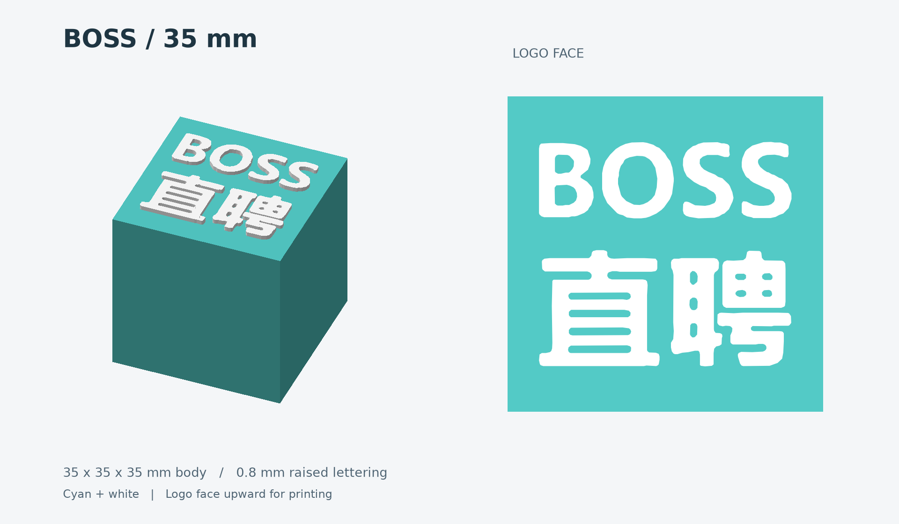
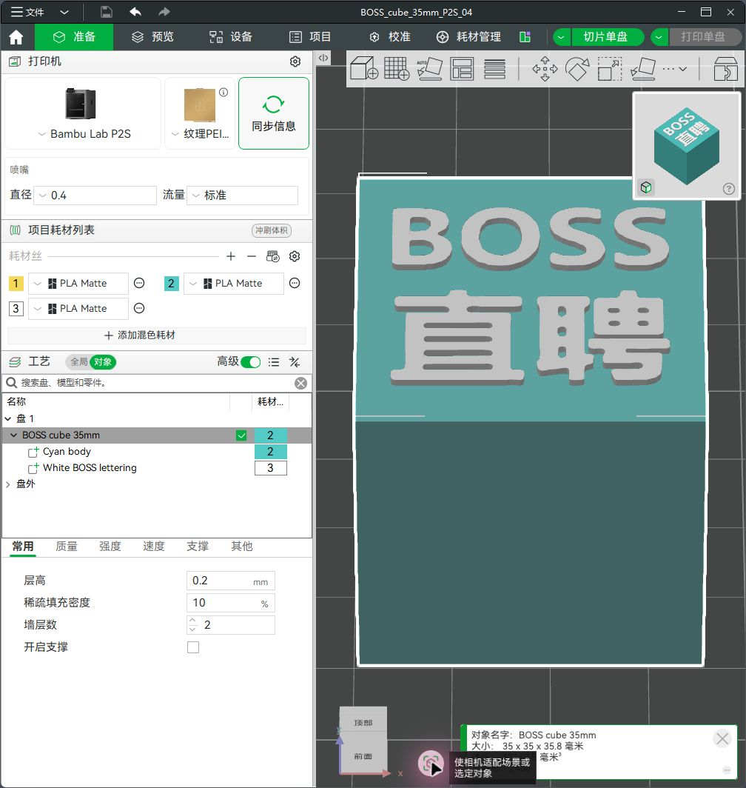
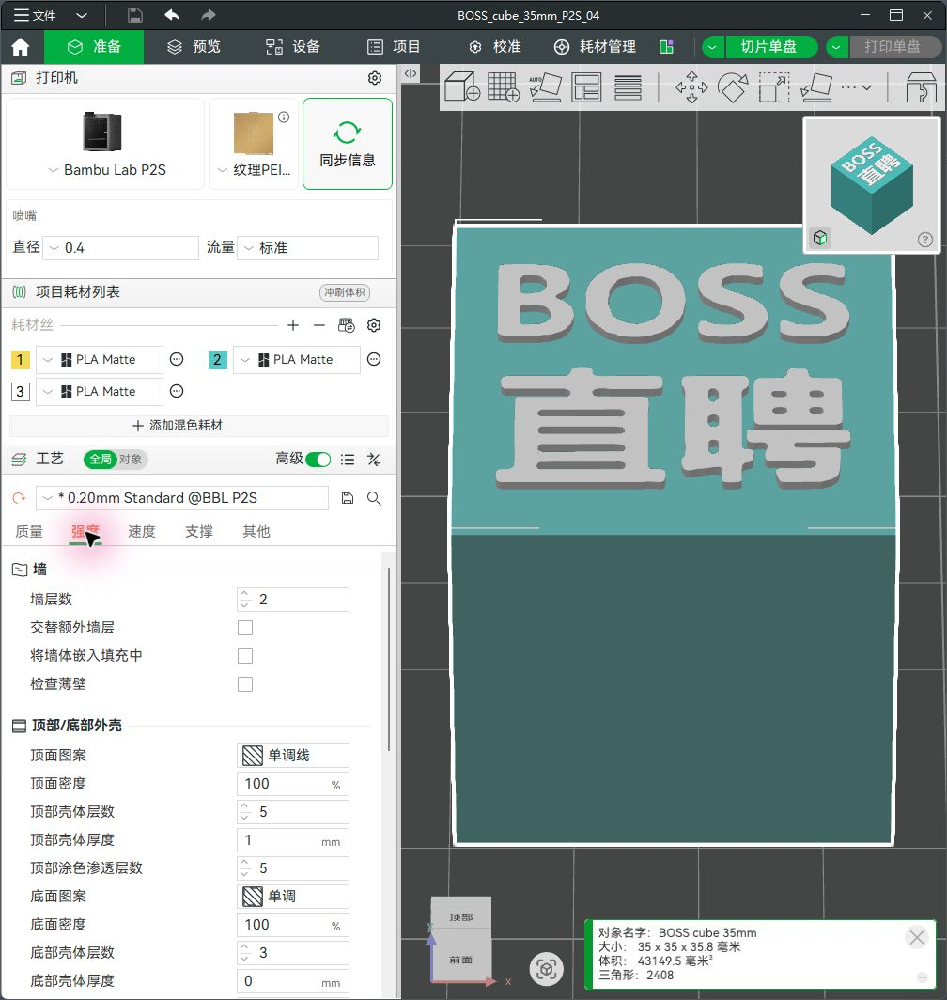
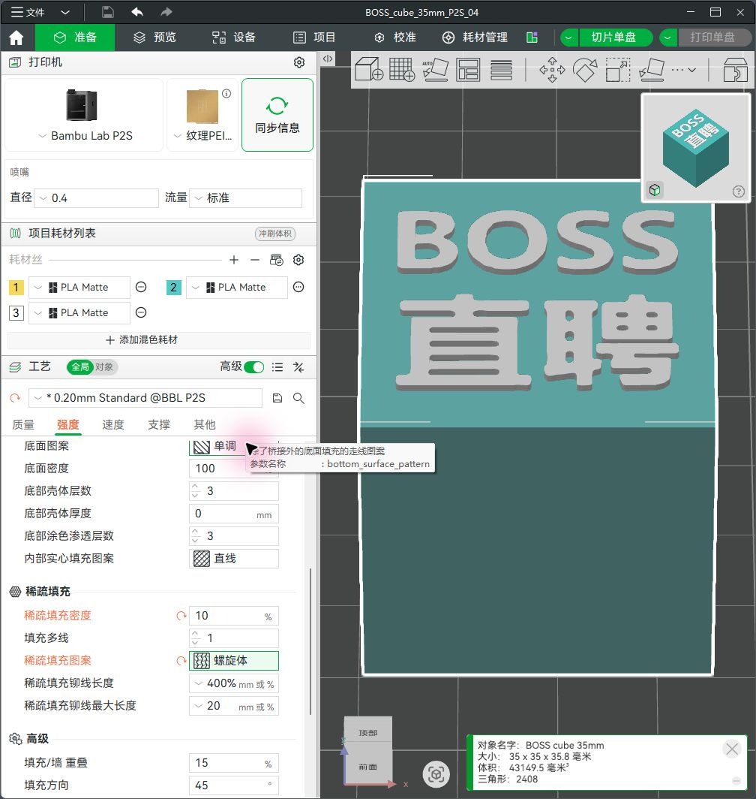
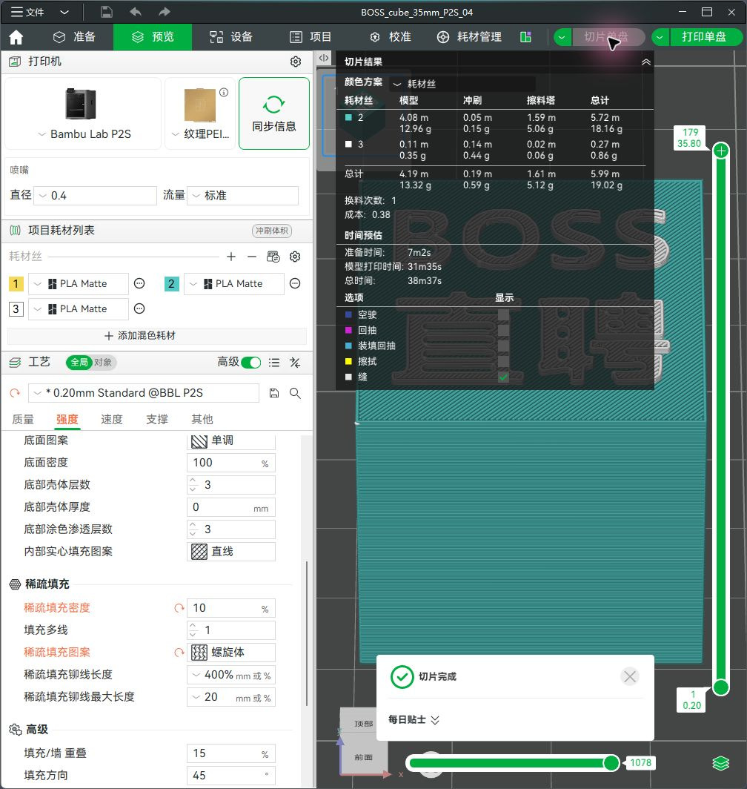
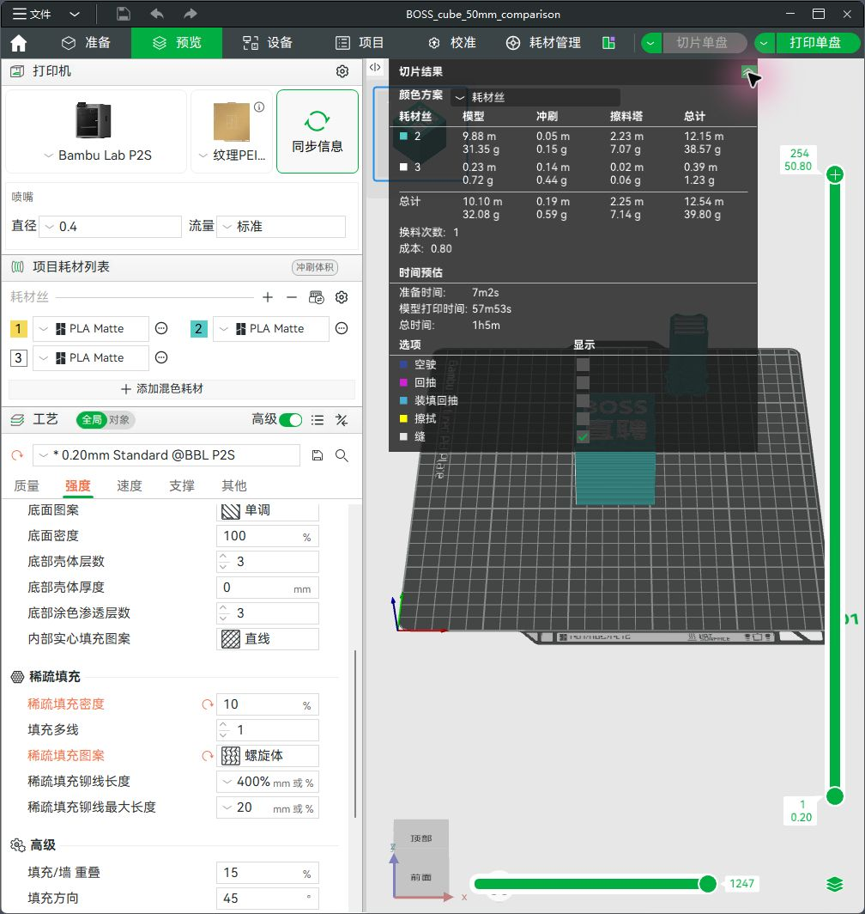
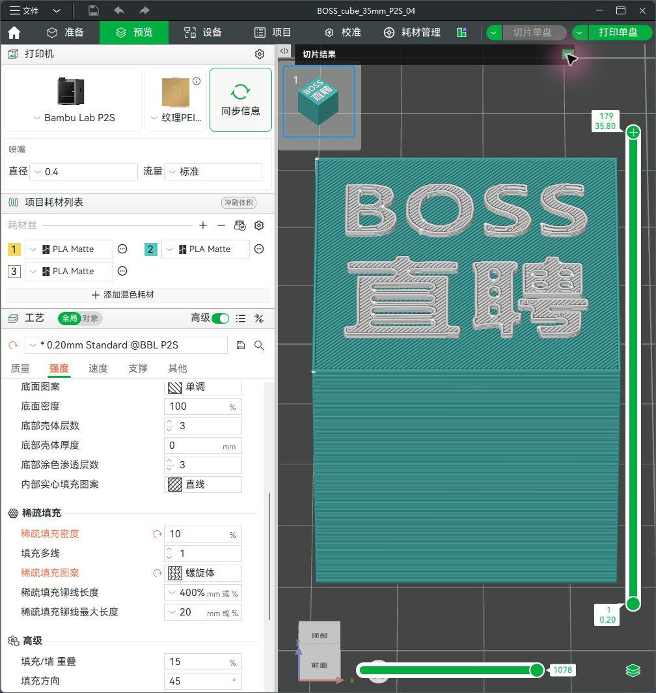
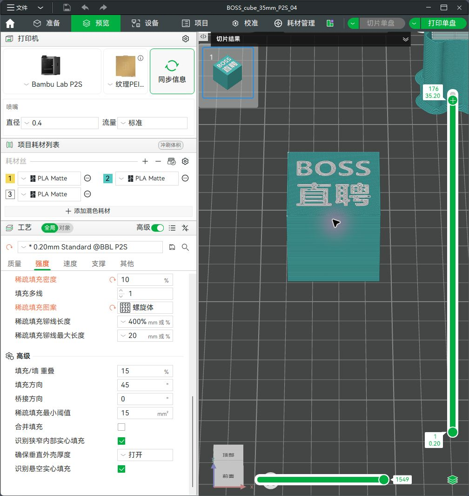
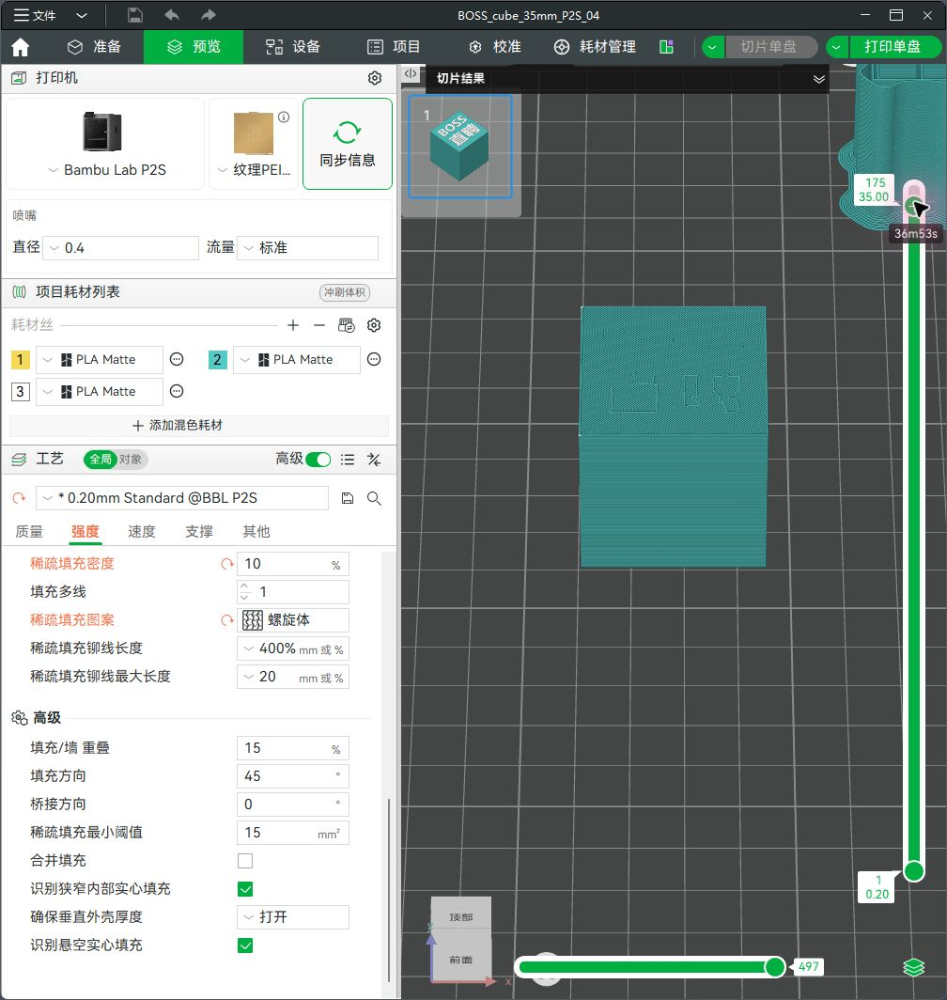

# BOSS Zhipin 35 mm two-color cube usage guide

English | [简体中文](使用说明.md)

Updated: 2026-11-01. Validation software: Bambu Studio 2.8.2.61 with the Chinese interface.

The revised model has completed modeling, import, process configuration, and slicing checks. No print job was sent. The original 50 mm files have been retained.

**The printer was disconnected during validation.** The project has cyan/white colors and PLA Matte filament presets configured, but the material, model, and physical AMS slots of the two actual rolls have not been read. Complete steps 3, 4, and 6 after reconnecting. Project filament numbers in this guide are not physical slot numbers.

## Delivery files and model specifications

Open **`BOSS_cube_35mm_P2S_04.3mf`** first. This Bambu Studio project includes the P2S 0.4 mm nozzle profile, process settings, and part color assignments.

| File | Purpose |
| --- | --- |
| `BOSS_cube_35mm_P2S_04.3mf` | Configured Bambu project; slice again to inspect it |
| `BOSS_cube_35mm.3mf` | Generic color model without a printer profile; both parts belong to one object |
| `body_cyan.stl`, `lettering_white.stl` | Separate body and lettering meshes with assembly coordinates preserved; STL does not store colors |
| `preview.png` | Appearance preview; actual colors depend on the filament |
| `source/` | Python source, reference image, and settings list for reproducing the model |
| `comparison/BOSS_cube_50mm_P2S_04_comparison.3mf` | 50 mm comparison project with the same process settings |
| `geometry_validation.json`, `project_validation.json` | Geometry and final project validation records |
| `slice_comparison.json` | Slicing estimates for both sizes and their validation conditions |
| `screenshots/` | Screenshots from the inspected interface, retained with this guide |

The body is a square-cornered **35 × 35 × 35 mm** cube. The white lettering is **28 mm** wide with **0.8 mm** relief, giving overall dimensions of **35 × 35 × 35.8 mm**. The lettering is extracted from the reference image, preserving uppercase “BOSS,” the second line “直聘,” internal holes, and layout. Print with the lettering facing upward and the back on the build plate; the other five faces have no artwork.

## 1. Open the revised project and identify both parts

1. In Bambu Studio, choose **File → Open Project** or press `Ctrl+O`, then open `BOSS_cube_35mm_P2S_04.3mf`. If asked how to open it, load the complete project to preserve process settings.
2. In the left-side process area, switch to **Objects** and expand **BOSS cube 35mm**.
3. Confirm that **Cyan body** and **White BOSS lettering** are present as two parts of the same object.
4. Inspect the top face: BOSS should appear above 直聘, without mirroring. Overall height should be 35.8 mm.

Use the revised file directly. Scaling the original entire object to 70% would also reduce the lettering relief to 0.56 mm; this revision keeps the relief at 0.8 mm.

## 2. Check the printer, nozzle, build plate, and process

The upper-left area of **Prepare** should show **Bambu Lab P2S**, a **0.4 mm** nozzle, and standard flow. The project was configured for the confirmed installed 0.4 mm nozzle. Its bed type is **Textured PEI Plate**. Check the actual plate before use and update the configuration if using a different one.

The process is based on the existing **0.20mm Standard @BBL P2S** preset, with the following project-level changes. An asterisk before the preset name indicates changes from the system preset; these are saved in the project.

| Page / setting | Saved value |
| --- | --- |
| Quality: layer height | 0.20 mm |
| Quality: initial layer height | 0.20 mm |
| Strength: wall loops | 2 |
| Strength: sparse infill density | 10% |
| Strength: sparse infill pattern | **Gyroid** |
| Strength: top shell layers | 5 |
| Strength: bottom shell layers | 3 |
| Support: enable support | Disabled |
| Quality: ironing | Disabled / no ironing |
| Others: prime tower | Enabled, with default settings retained |
| Project filaments: flushing volumes | Existing default configuration retained |

In the inspected Chinese interface, Gyroid is labeled “螺旋体”; it is a different option from Grid (“网格”). Select **Global** when changing settings so that neither part is missed.

## 3. Synchronize AMS filaments after reconnecting

1. Select your P2S on the **Device** tab. Confirm that it is online and AMS information is available. If it still shows no printer, complete the connection first. You can continue inspecting the model offline.
2. Check and record the color, material, brand/model, and slot of each actual AMS roll. Use the slots shown by the device, including an AMS unit number where applicable.
3. Return to **Prepare**. Use the synchronization control beside the printer to check the hardware configuration, then use the **filament synchronization icon** beside the project filament list to synchronize AMS filament information. Synchronizing printer information does not by itself complete filament synchronization.
4. Review the project filament list after synchronization. If a mapping or overwrite choice appears, check part colors and filament settings again after resolving it. Third-party or manually registered filament settings should match the spool label.

The official P2S manual describes synchronization from the project filament list. Button wording may vary between Studio versions. See the [official P2S user manual](https://csm.bblcdn.com/hub/9425242c00344b0e801b6179f9a243aa.pdf).

**This project retains `Bambu PLA Matte @BBL P2S`; the actual filament has not been verified.** If the rolls are PLA Basic, another brand of PLA, or a different material, choose the matching filament presets and slice again. The cyan and white rolls must be suitable for printing together in this joined model; color alone does not establish material compatibility.

## 4. Assign body and lettering filaments, and distinguish project numbers from slots

The saved Bambu project uses these assignments:

| Part / purpose | Project filament number | Displayed color | Current filament preset | Physical AMS slot |
| --- | --- | --- | --- | --- |
| Cyan body | **2** | Cyan `#53CAC6` | Bambu PLA Matte; actual roll unverified | Confirm after connecting |
| White BOSS lettering | **3** | White `#FFFFFF` | Bambu PLA Matte; actual roll unverified | Confirm after connecting |
| Unused filament from the original project | 1 | Yellow | Not used when slicing this model | No model mapping needed |

Project numbers identify entries in the project's material list. AMS slots are physical feeding locations. **Project filament 2 does not mean AMS slot 2, and project filament 3 does not mean slot 3.** The generic color 3MF may also use a different internal color order, so always check the part, material, and color together.

In **Objects**, click the filament color block on the **Cyan body** row and select the cyan filament from the current list. Do the same for **White BOSS lettering**, selecting white. Expand the object and set each part individually rather than changing only the parent object. The saved parent object is also assigned to cyan.

Synchronization may reorder the list, so check both parts afterward. Keeping a yellow entry in the list does not mean yellow will be printed; inspect the materials actually used in the slicing statistics.

Here, a filament change means **AMS automatically switching from cyan to white**. With both rolls loaded and correctly mapped, there is no need to pause, replace a roll manually, or add a separate pause-for-filament-change command.

## 5. Slice and inspect lettering and filament usage

Click **Slice Plate** in the upper-right corner. After slicing, open **Preview**, expand the slicing results, and set the color scheme to **Filament**.

The following estimates were obtained with the same process settings for both sizes. The 50 mm interface rounds its time to “1h5m”; the slicing data records 1 hr 4 min 55 sec.

| Metric | Revised 35 mm | 50 mm comparison |
| --- | ---: | ---: |
| Preparation time | 7 min 2 sec | 7 min 2 sec |
| Model printing phase | 31 min 35 sec | 57 min 53 sec |
| **Total estimated time** | **38 min 37 sec** | **Approx. 1 hr 5 min** |
| **Total filament, including flushing and prime tower** | **19.02 g** | **39.80 g** |
| Model filament | 13.32 g | 32.08 g |
| Flushing filament | 0.59 g | 0.59 g |
| Prime tower filament | 5.12 g | 7.14 g |
| Total cyan | 18.16 g | 38.57 g |
| Total white | 0.86 g | 1.23 g |
| Filament changes | 1 | 1 |
| Total layers | 179 | 254 |

The interface rounds each value separately, so sums can differ by 0.01 g. The 35 mm version is estimated to reduce total time by **40.5%** and total filament by **52.2%**. These are software estimates for the existing PLA Matte configuration, not a volume-based guarantee or measured print times.

Inspect the result in this order:

1. The statistics should show only cyan and white as actually used filaments. The saved project uses filaments **2 and 3**, with **1** filament change. If yellow usage appears, return to step 4 and check every part assignment.
2. Use the layer slider on the right to inspect the top. The body ends at **layer 175 / Z=35.0 mm**. White lettering begins at **layer 176 / Z=35.2 mm** and continues through **layer 179 / Z=35.8 mm**, for four layers.
3. Zoom in on BOSS and 直聘. Confirm that every stroke has a toolpath and that the holes in B, O, and the Chinese characters remain open. The first white layer should sit on the cyan top surface, not on the plate or unsupported outside the body.
4. Check that the cyan surface beneath the lettering is continuous. Retain the default prime tower: it is an auxiliary structure beside the model that stabilizes extrusion after a color change, not a second cube deliverable.
5. A yellow-colored “wipe” marker in the flushing legend represents an action and does not necessarily mean yellow filament. Judge unexpected color use from the **Filament** color scheme and material statistics.

The following screenshots show the first white layer at layer 176 and the cyan contact surface at layer 175. Both were inspected layer by layer: the lettering strokes have toolpaths, and the cyan surface beneath them is continuous.

## 6. Confirm the mapping in the send dialog and start printing yourself

Complete this step after reconnecting and preparing to print. No send, upload, or print-start action was performed during validation.

1. After synchronization, reassignment, and slicing checks, click **Print Plate** to open the send dialog.
2. Select your online P2S, check the nozzle and build plate information, and confirm AMS use.
3. In filament mapping, verify each assignment: **cyan body → actual cyan roll slot; white lettering → actual white roll slot**. Check material as well as color, and verify automatic mappings.
4. If a slot is empty, a material does not match, both colors map to one roll, or the actual nozzle differs, cancel sending and correct the problem first. Slice again after changing filament presets.
5. Once both mappings are correct and the build plate is ready, click the final **Send / Start Printing** control yourself.

For general synchronization and mapping principles, see Bambu's [filament mapping documentation in the H2C manual](https://csm.bblcdn.com/hub/eff78da43720461787dc8bbe5fa0372d.pdf). The final mapping must match the physical filament present at the time of printing.

## 7. Troubleshooting

| Symptom | Action |
| --- | --- |
| Body is white and lettering is cyan | Expand the object, correct each part's filament assignment, slice again, and recheck slots in the send dialog. |
| Colors or numbers changed after synchronization | Reassign parts by color and material. Old project numbers do not identify entries in the new list or physical AMS slots. |
| A 0.2 mm nozzle is still shown, or a nozzle mismatch appears | Check the actual hardware and the P2S 0.4 mm configuration, then synchronize after connecting. Changing Studio to 0.4 mm does not change the installed nozzle. |
| Lettering strokes or holes disappear | Confirm the revised model's 35.8 mm total height, 0.4 mm nozzle, and 0.2 mm layers. Inspect layers 176–179 closely. Do not shrink the lettering width further or scale its relief height proportionally. If line widths or the wall generator were changed, return to the delivered project first. |
| White lettering drops to the build plate | It was likely imported as a separate object and automatically placed on the plate. Undo and use the complete 3MF, or import both STL files together as parts of one object while preserving relative coordinates. |
| Print time is still long | Check the 35 mm size, 0.4 mm nozzle, 0.2 mm layers, 10% Gyroid infill, and absence of extra copies or supports. Preparation, flushing, and prime tower costs do not scale directly with model volume. Retain the saved default tower and flushing settings; recheck after any changes. |
| Import warns that the 3MF configuration is invalid and only geometry will be loaded | This can occur with generic `BOSS_cube_35mm.3mf`, which does not include a complete Studio process configuration. It can still be imported as geometry, but requires printer, process, and color selection. Open the `_P2S_04` project to use the saved process. |
| Yellow project filament 1 is present | The original unused yellow entry was retained. Final slicing used only cyan and white. An entry's presence in the list does not establish actual usage. |
| No printer is connected | You can inspect and slice offline. Confirm physical AMS slots and actual materials after connecting; offline project settings do not establish verified device mapping. |

## Validation scope

Completed checks include watertight meshes for both parts, consistent winding, and positive volume; a 35 mm body; 28 mm lettering width and 0.8 mm thickness; contact between the lettering bottom and body top at Z=35 mm; all strokes within the body's footprint; and retention of 8 lettering components and 14 outline holes. The final Bambu project's meshes and parameters were checked separately.

The project was imported and sliced in Bambu Studio. Checks covered both parts, cyan/white assignments, top lettering toolpaths, the layer 175 cyan contact surface, the layer 176 first white layer, filament changes, and statistics. The slicing record uses only project filaments 2 and 3, with no yellow filament toolpaths. Software checks do not replace a physical print test for adhesion, color coverage, or dimensional accuracy.

Not completed: reading actual AMS slots and filament models from the disconnected printer, checking physical slot mapping in the send dialog, and a physical print test. Complete these after reconnecting and deciding to print.

Use the screenshots as the reference for control locations in the inspected interface. Process values come from the checked project; official documentation is provided for synchronization and mapping guidance. The original 50 mm delivery files were not overwritten.
